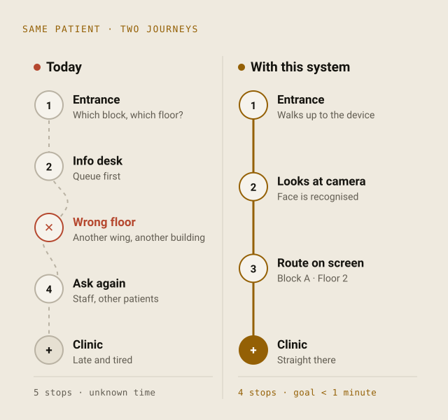
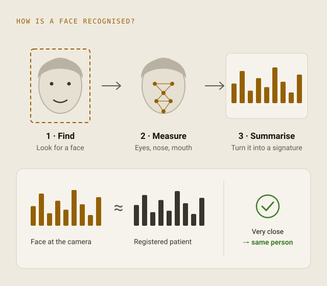
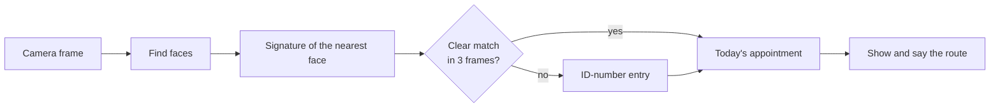
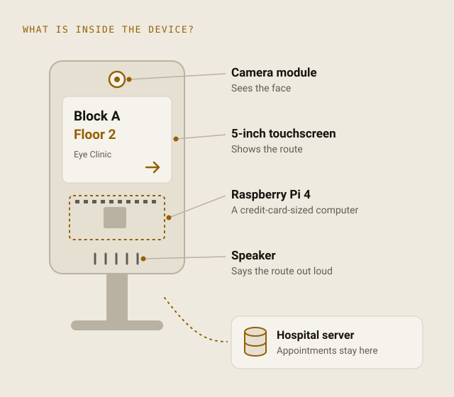

<div align="center">

# hasta-yonlendirme

### A contactless wayfinding kiosk for hospitals

The patient looks at the camera. The kiosk recognises them, finds today's appointment<br>
and shows **and says** where to go: block, floor, clinic and doctor.

[](https://github.com/YusufsKaygusuz/hasta-yonlendirme/actions/workflows/ci.yml)
[](LICENSE)


**English** · [Türkçe](README.tr.md)

</div>

<p align="center">
  <picture>
    <source media="(prefers-color-scheme: dark)" srcset="docs/images/journey-dark.svg">
    
  </picture>
</p>

## Contents

- [Why](#why)
- [What it does](#what-it-does)
- [Try it in two minutes](#try-it-in-two-minutes)
- [Add face recognition](#add-face-recognition)
- [The kiosk screens](#the-kiosk-screens)
- [How it works](#how-it-works)
- [Privacy at a glance](#privacy-at-a-glance)
- [Hardware](#hardware)
- [Configuration](#configuration) · [Commands](#commands) · [Project structure](#project-structure)
- [Connecting to a hospital system](#connecting-to-a-hospital-system)
- [Development](#development) · [Roadmap](#roadmap) · [Responsible use](#responsible-use)
- [Background and citation](#background-and-citation) · [License](#license)

## Why

In a study of 319 patients across 10 outpatient clinics, the average waiting time was
**64.2 minutes**, against **9.85 minutes** of examination
([Mazaheri Habibi et al., 2018](https://doi.org/10.4103/japtr.JAPTR_134_18)).
Finding the way is only part of that time, but an entirely preventable part, and it also
costs the staff who answer the same question all day.

hasta-yonlendirme (Turkish for *patient routing*) is a small kiosk at the hospital entrance
that answers that question in a few seconds, built from a Raspberry Pi and open-source software.

## What it does

**For patients**

- Look at the camera, see the route: block, floor, clinic, room, doctor and time.
- Hear it too, in Turkish or English, for patients who cannot easily read the screen.
- Not recognised? Type the national ID number on the touchscreen instead. The fallback is always there.

**For hospitals**

- Costs a fraction of a commercial kiosk: a Raspberry Pi 4, a camera module, a 5-inch touchscreen and a speaker.
- Works offline. Recognition and speech run on the device; only appointments come from your server.
- Keeps working when parts fail: without a camera it switches to ID-number mode instead of stopping.
- Privacy by design: no photos stored, ID numbers hashed, consent required, one command to erase a patient's face data.
- Connects to an existing hospital information system through one small interface.

**For developers**

- Typed, linted Python with 110+ tests that run without a camera, plus CI against MySQL.
- Clear layers: the kiosk's behaviour is a state machine with no GUI code, so it is fully testable.
- Turkish and English throughout, easy to extend.

## Try it in two minutes

No camera or face library needed: the kiosk starts in ID-number mode.

```bash
git clone https://github.com/YusufsKaygusuz/hasta-yonlendirme.git
cd hasta-yonlendirme
python3 -m venv .venv && source .venv/bin/activate
pip install -e .

export HY_ID_PEPPER="$(openssl rand -hex 32)"   # secret for hashing ID numbers
hasta-yonlendirme demo                           # fictional clinics, doctors and patients
hasta-yonlendirme run                            # opens the kiosk window (Ctrl+Q to quit)
```

On Linux, Tkinter may need `sudo apt install python3-tk`. The kiosk speaks Turkish by default;
set `language = "en"` under `[kiosk]` in the [config file](#configuration) for English.

Press **"TC kimlik no ile devam et"** and type `11111111110`: the kiosk shows (and, if a speech
engine is installed, says) the way to a demo patient's appointment. `33333333330` is a patient
with no appointment today. The demo ID numbers are obviously fake test values.

No display? Use `hasta-yonlendirme run --headless` and type the number in the terminal.

## Add face recognition

```bash
pip install -e ".[face,camera]"   # dlib compiles once; needs CMake and a C++ compiler
hasta-yonlendirme enroll --first-name Ada --last-name Lovelace --photo ada.jpg --consent
hasta-yonlendirme add-appointment --clinic 1 --doctor 1 --at "2026-11-02 14:30"
hasta-yonlendirme run
```

`enroll` and `add-appointment` ask for the national ID number rather than taking it on the
command line, so it never ends up in your shell history. The photo is used once to compute a
face encoding and is not stored. Then stand in front of the webcam.

For a real kiosk, follow the **[Raspberry Pi setup guide](docs/raspberry-pi.md)**.

## The kiosk screens

| Screen | When | What the patient sees and hears |
|---|---|---|
| Welcome | Nobody in front of the camera | "Please look at the camera", and a button for the ID-number path |
| Recognising | A face is in view | A short "Recognising…" while frames are compared |
| Route | Patient recognised, appointment found | "Hello Ayşe D.", **Block A · Floor 2**, clinic, room, doctor, time and directions; spoken aloud |
| No appointment | Recognised, nothing today, or an unknown ID | "Please ask at the information desk"; spoken aloud |
| Not recognised | A face stayed but matched no one | An offer to continue with the ID number; spoken aloud |
| ID entry | Button pressed, or a digit typed on a keyboard | A large keypad; only the last digit typed is visible |
| Camera unavailable | Camera or face library missing | The ID-number path, so the kiosk is never useless |

Results stay on screen for 12 seconds, and a patient still standing at the kiosk is not greeted again.
Screens scale from the 5-inch 800×480 display to full HD, and a test checks that every screen
fits at each size in both languages.

## How it works

<p align="center">
  <picture>
    <source media="(prefers-color-scheme: dark)" srcset="docs/images/face-signature-dark.svg">
    
  </picture>
</p>

A face is turned into a short list of numbers, a *face signature*, and compared with the
signatures of registered patients. The [dlib](http://dlib.net/) model used here reports
99.38% accuracy on the [Labeled Faces in the Wild](http://vis-www.cs.umass.edu/lfw/) benchmark.
A hospital entrance is harder than a benchmark, so the kiosk is deliberately strict:

| Rule | Default | Why |
|---|---|---|
| Only the largest face counts | | The person at the kiosk, not people walking past |
| Distance must be below the tolerance | 0.5 (library default 0.6) | Stricter means fewer wrong matches |
| Best match must clearly beat the runner-up | margin 0.06 | Two similar-looking patients give "not recognised", not a guess |
| Several frames must agree | 3 in a row | One lucky frame cannot route someone to the wrong clinic |



More detail, including the state machine and data flow: [docs/architecture.md](docs/architecture.md).

## Privacy at a glance

| Data | Stored? |
|---|---|
| Camera images | **Never.** Processed in memory and discarded |
| Enrolment photos | **Never.** Only the face encoding computed from them |
| National ID numbers | **Never in clear.** Keyed hash (HMAC-SHA256) with a secret kept outside the database |
| Name on screen | First name and initial only: "Ayşe D." |
| Face data without consent | Refused: `enroll` requires `--consent` |
| Right to erasure | `hasta-yonlendirme forget` deletes a patient's face data |

An unknown ID number and a registered one without an appointment produce the same screen,
so nobody can find out who is registered. Full details and the operator's obligations under
KVKK and GDPR: [docs/privacy.md](docs/privacy.md).

## Hardware

<p align="center">
  <picture>
    <source media="(prefers-color-scheme: dark)" srcset="docs/images/device-dark.svg">
    
  </picture>
</p>

| Part | Used in the project |
|---|---|
| Computer | Raspberry Pi 4 (2 GB or more) |
| Camera | Raspberry Pi Camera Module v2 (v3 and USB webcams also work) |
| Screen | 5-inch 800×480 HDMI touchscreen |
| Audio | Small USB speaker |
| Power | Official Raspberry Pi 4 power supply |

Speech uses espeak-ng on the Raspberry Pi and the built-in voices on macOS, both offline.
Setup, autostart on boot and troubleshooting: [docs/raspberry-pi.md](docs/raspberry-pi.md).

## Configuration

Everything works with defaults. To change settings, copy
[`config/hasta-yonlendirme.example.toml`](config/hasta-yonlendirme.example.toml) to
`./hasta-yonlendirme.toml` or `/etc/hasta-yonlendirme/config.toml`; every option is
documented there. Secrets are read only from environment variables:

| Variable | Purpose |
|---|---|
| `HY_ID_PEPPER` | Secret for hashing national ID numbers. Required, at least 16 bytes. Back it up. |
| `HY_DB_PASSWORD` | MySQL password (only with `backend = "mysql"`) |

## Commands

| Command | What it does |
|---|---|
| `run [--headless]` | Start the kiosk (touch UI, or text UI with `--headless`) |
| `demo` | Create tables and fill them with fictional sample data |
| `init-db` | Create the database tables |
| `enroll` | Register a patient's face from one or more photos (`--consent` required) |
| `forget` | Erase a patient's face data |
| `add-clinic`, `add-doctor`, `add-appointment` | Add data for testing |
| `check-camera` | Test the camera and measure frames per second |

Global options go before the command: `hasta-yonlendirme --config PATH -v run`.

## Project structure

```
src/hasta_yonlendirme/
├── recognition/   find, encode and match faces; multi-frame confirmation
├── storage/       Repository interface, SQLite and MySQL
├── kiosk/         state machine, camera thread, touch and text interfaces
├── routing.py     which appointment to show
├── identity.py    national ID checksum and hashing
├── announcer.py   spoken directions
└── cli.py         command-line interface
docs/              Raspberry Pi guide, architecture, privacy
deploy/            systemd service for starting on boot
tests/             runs without camera or dlib
```

## Connecting to a hospital system

The kiosk reads patients and appointments through the
[`Repository`](src/hasta_yonlendirme/storage/base.py) interface: four read methods.
Implement them on top of your hospital information system, a read-only replica or an
HL7 FHIR API, and nothing else needs to change. Examples in
[docs/architecture.md](docs/architecture.md#connecting-to-your-hospital-system).

## Development

```bash
pip install -e ".[dev]"
pytest                                   # no camera needed
ruff check . && ruff format --check .
mypy
```

Contributions in English or Turkish are welcome; please read [CONTRIBUTING.md](CONTRIBUTING.md).
Security or privacy issues: see [SECURITY.md](SECURITY.md).

## Roadmap

- [ ] Liveness detection against printed photos and screens
- [ ] HL7 FHIR repository for hospital information systems
- [ ] More natural offline voice (neural text-to-speech)
- [ ] Accessibility mode with larger text and slower speech

## Responsible use

Face data is a special category of personal data under Türkiye's KVKK (Law No. 6698) and the
EU GDPR. Before deploying in a real hospital: get legal review, collect explicit consent,
publish a privacy notice, always offer the ID-number path, and test with your own patient
population, because face recognition does not perform equally well for everyone
([NIST IR 8280](https://doi.org/10.6028/NIST.IR.8280)). The software is provided as is,
without warranty ([LICENSE](LICENSE)).

## Background and citation

Developed by **Yusuf Sami Kaygusuz** as a TÜBİTAK 2209-A undergraduate research project at
Yalova University, Department of Computer Engineering, advised by Assoc. Prof. Adem Tuncer.
The story behind the project, with its sources, is in the
[project write-up](https://www.yusufskaygusuz.com/en/posts/yuz-tanima-hasta-yonlendirme/).

If you use it in research, please cite it: GitHub shows a *Cite this repository* button
generated from [CITATION.cff](CITATION.cff).

## License

[MIT](LICENSE) © Yusuf Sami Kaygusuz
