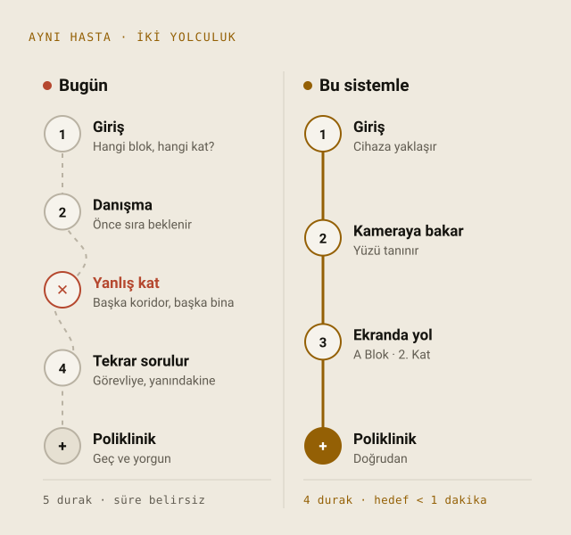
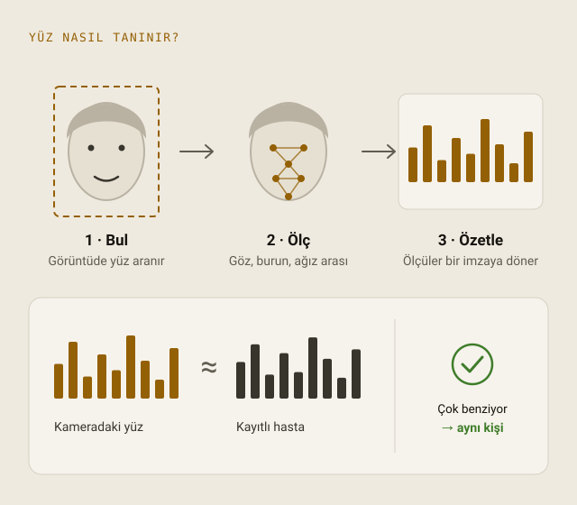
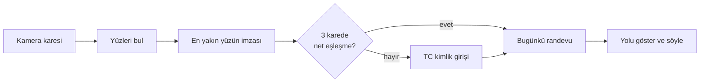
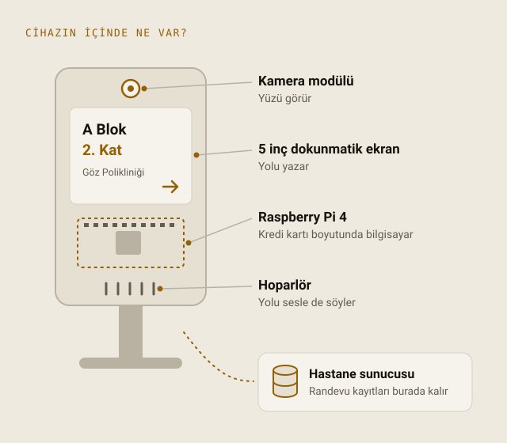

<div align="center">

# hasta-yonlendirme

### Hastaneler için temassız yönlendirme kioskı

Hasta kameraya bakar. Kiosk onu tanır, bugünkü randevusunu bulur<br>
ve nereye gideceğini ekranda **gösterir ve sesli söyler**: blok, kat, poliklinik ve doktor.

[](https://github.com/YusufsKaygusuz/hasta-yonlendirme/actions/workflows/ci.yml)
[](LICENSE)


[English](README.md) · **Türkçe**

</div>

<p align="center">
  <picture>
    <source media="(prefers-color-scheme: dark)" srcset="docs/images/journey-dark.tr.svg">
    
  </picture>
</p>

## İçindekiler

- [Neden?](#neden)
- [Ne yapar?](#ne-yapar)
- [Hemen deneyin](#hemen-deneyin)
- [Yüz tanımayı ekleyin](#yüz-tanımayı-ekleyin)
- [Kiosk ekranları](#kiosk-ekranları)
- [Nasıl çalışır?](#nasıl-çalışır)
- [Bir bakışta gizlilik](#bir-bakışta-gizlilik)
- [Donanım](#donanım)
- [Yapılandırma](#yapılandırma) · [Komutlar](#komutlar) · [Proje yapısı](#proje-yapısı)
- [Hastane bilgi sistemine bağlamak](#hastane-bilgi-sistemine-bağlamak)
- [Geliştirme](#geliştirme) · [Yol haritası](#yol-haritası) · [Sorumlu kullanım](#sorumlu-kullanım)
- [Arka plan ve atıf](#arka-plan-ve-atıf) · [Lisans](#lisans)

## Neden?

10 poliklinikte 319 hastayla yapılan bir çalışmada ortalama bekleme süresi **64,2 dakika**,
muayene süresi ise **9,85 dakika** ölçülmüş
([Mazaheri Habibi vd., 2018](https://doi.org/10.4103/japtr.JAPTR_134_18)).
Yol bulmak bu sürenin yalnızca bir parçası, ama tamamen önlenebilir bir parçası. Üstelik gün
boyu aynı soruyu yanıtlayan personelin de zamanını alıyor.

hasta-yonlendirme, hastane girişine konan küçük bir kiosk: bu soruyu birkaç saniyede yanıtlıyor
ve bir Raspberry Pi ile açık kaynak yazılımlardan oluşuyor.

## Ne yapar?

**Hastalar için**

- Kameraya bakın, yolu görün: blok, kat, poliklinik, oda, doktor ve saat.
- Yolu sesli de duyun; Türkçe ya da İngilizce. Ekranı okumakta zorlanan hastalar için.
- Tanınmadınız mı? TC kimlik numaranızı dokunmatik ekrana girin. B planı her zaman hazır.

**Hastaneler için**

- Ticari kiosk maliyetinin çok küçük bir kısmı: Raspberry Pi 4, kamera modülü, 5 inç dokunmatik ekran ve hoparlör.
- İnternetsiz çalışır. Tanıma ve ses cihazın üzerinde; sunucudan yalnızca randevular gelir.
- Parçalar bozulsa da çalışır: kamera yoksa durmaz, TC kimlik moduna geçer.
- Tasarımdan gelen gizlilik: fotoğraf saklanmaz, TC numaraları özetlenir, açık rıza şarttır, tek komutla yüz verisi silinir.
- Tek bir küçük arayüzle mevcut hastane bilgi sistemine bağlanır.

**Geliştiriciler için**

- Tip denetimli, lint'li Python; kamerasız çalışan 110'dan fazla test ve MySQL'e karşı CI.
- Net katmanlar: kioskun davranışı GUI kodu içermeyen bir durum makinesi, tamamen test edilebilir.
- Baştan sona Türkçe ve İngilizce; yeni dil eklemek kolay.

## Hemen deneyin

Kamera ya da yüz tanıma kütüphanesi gerekmez: kiosk TC kimlik moduyla açılır.

```bash
git clone https://github.com/YusufsKaygusuz/hasta-yonlendirme.git
cd hasta-yonlendirme
python3 -m venv .venv && source .venv/bin/activate
pip install -e .

export HY_ID_PEPPER="$(openssl rand -hex 32)"   # TC numaralarını özetlemek için gizli anahtar
hasta-yonlendirme demo                           # kurgusal poliklinik, doktor ve hastalar
hasta-yonlendirme run                            # kiosk penceresini açar (çıkmak için Ctrl+Q)
```

Linux'ta Tkinter için `sudo apt install python3-tk` gerekebilir.

**"TC kimlik no ile devam et"** düğmesine basın ve `11111111110` yazın: kiosk demo hastanın
randevusuna giden yolu gösterir (konuşma motoru kuruluysa sesli de söyler). `33333333330`
bugün randevusu olmayan bir hasta. Demo numaraları açıkça sahte test değerleridir.

Ekran yok mu? `hasta-yonlendirme run --headless` ile numarayı terminale yazın.

## Yüz tanımayı ekleyin

```bash
pip install -e ".[face,camera]"   # dlib bir kez derlenir; CMake ve C++ derleyicisi gerekir
hasta-yonlendirme enroll --first-name Ada --last-name Lovelace --photo ada.jpg --consent
hasta-yonlendirme add-appointment --clinic 1 --doctor 1 --at "2026-11-02 14:30"
hasta-yonlendirme run
```

`enroll` ve `add-appointment` TC kimlik numarasını komut satırından almak yerine sorar; böylece
numara kabuk geçmişine düşmez. Fotoğraf yalnızca bir kez yüz imzasını hesaplamak için kullanılır
ve saklanmaz. Sonra web kamerasının önüne geçin.

Gerçek bir kiosk için **[Raspberry Pi kurulum kılavuzunu](docs/raspberry-pi.md)** izleyin.

## Kiosk ekranları

| Ekran | Ne zaman? | Hasta ne görür, ne duyar? |
|---|---|---|
| Karşılama | Kameranın önünde kimse yok | "Lütfen kameraya bakın" ve TC kimlik düğmesi |
| Tanınıyor | Bir yüz görüş alanında | Kareler karşılaştırılırken kısa bir "Yüzünüz tanınıyor…" |
| Yol tarifi | Hasta tanındı, randevu bulundu | "Merhaba Ayşe D.", **A Blok · 2. Kat**, poliklinik, oda, doktor, saat ve yol notu; sesli olarak da |
| Randevu yok | Tanındı ama bugün randevu yok, ya da bilinmeyen numara | "Lütfen danışma masasına başvurun"; sesli olarak da |
| Tanınmadı | Yüz durdu ama kimseyle eşleşmedi | TC kimlik numarasıyla devam önerisi; sesli olarak da |
| TC kimlik girişi | Düğmeye basıldı ya da klavyeden rakam yazıldı | Büyük tuş takımı; yalnızca son yazılan rakam görünür |
| Kamera yok | Kamera ya da yüz tanıma kütüphanesi yok | TC kimlik yolu; kiosk hiçbir zaman işe yaramaz hale gelmez |

Sonuçlar 12 saniye ekranda kalır; kioskun önünde hâlâ duran hasta tekrar selamlanmaz. Ekranlar
5 inç 800×480 ekrandan Full HD'ye kadar ölçeklenir; her ekranın her boyutta ve iki dilde sığdığını
bir test kontrol eder.

## Nasıl çalışır?

<p align="center">
  <picture>
    <source media="(prefers-color-scheme: dark)" srcset="docs/images/face-signature-dark.tr.svg">
    
  </picture>
</p>

Yüz, kısa bir sayı dizisine, yani bir *yüz imzasına* çevrilir ve kayıtlı hastaların imzalarıyla
karşılaştırılır. Kullanılan [dlib](http://dlib.net/) modeli
[Labeled Faces in the Wild](http://vis-www.cs.umass.edu/lfw/) test setinde %99,38 doğruluk
bildiriyor. Hastane girişi bir test setinden daha zor; bu yüzden kiosk bilerek katıdır:

| Kural | Varsayılan | Neden? |
|---|---|---|
| Yalnızca en büyük yüz sayılır | | Kioskun önündeki kişi, yoldan geçenler değil |
| Mesafe eşiğin altında olmalı | 0,5 (kütüphane varsayılanı 0,6) | Daha katı eşik, daha az yanlış eşleşme |
| En iyi eşleşme ikinciyi açıkça geçmeli | fark 0,06 | Birbirine benzeyen iki hastada tahmin değil "tanınmadı" |
| Birkaç kare aynı sonucu vermeli | art arda 3 | Tek bir şanslı kare kimseyi yanlış polikliniğe gönderemez |



Durum makinesi ve veri akışıyla birlikte ayrıntılar: [docs/architecture.md](docs/architecture.md).

## Bir bakışta gizlilik

| Veri | Saklanıyor mu? |
|---|---|
| Kamera görüntüleri | **Asla.** Bellekte işlenir ve atılır |
| Kayıt fotoğrafları | **Asla.** Yalnızca onlardan hesaplanan yüz imzası |
| TC kimlik numaraları | **Açık haliyle asla.** Veritabanı dışında tutulan gizli anahtarla özet (HMAC-SHA256) |
| Ekrandaki isim | Yalnızca ad ve soyadın baş harfi: "Ayşe D." |
| Rızasız yüz verisi | Reddedilir: `enroll` için `--consent` şart |
| Silme hakkı | `hasta-yonlendirme forget` hastanın yüz verisini siler |

Bilinmeyen bir TC numarası ile randevusu olmayan kayıtlı bir numara aynı ekranı gösterir; böylece
kimin kayıtlı olduğu öğrenilemez. Ayrıntılar ve KVKK/GDPR kapsamında işletmecinin yükümlülükleri:
[docs/privacy.md](docs/privacy.md).

## Donanım

<p align="center">
  <picture>
    <source media="(prefers-color-scheme: dark)" srcset="docs/images/device-dark.tr.svg">
    
  </picture>
</p>

| Parça | Projede kullanılan |
|---|---|
| Bilgisayar | Raspberry Pi 4 (2 GB veya üzeri) |
| Kamera | Raspberry Pi Kamera Modülü v2 (v3 ve USB web kameraları da çalışır) |
| Ekran | 5 inç 800×480 HDMI dokunmatik ekran |
| Ses | Küçük USB hoparlör |
| Güç | Resmî Raspberry Pi 4 güç adaptörü |

Ses, Raspberry Pi'de espeak-ng, macOS'ta sistemin kendi sesleriyle üretilir; ikisi de internetsiz.
Kurulum, açılışta otomatik başlatma ve sorun giderme: [docs/raspberry-pi.md](docs/raspberry-pi.md).

## Yapılandırma

Her şey varsayılan değerlerle çalışır. Ayarları değiştirmek için
[`config/hasta-yonlendirme.example.toml`](config/hasta-yonlendirme.example.toml) dosyasını
`./hasta-yonlendirme.toml` ya da `/etc/hasta-yonlendirme/config.toml` olarak kopyalayın; her
ayar dosyada açıklanmıştır. Gizli bilgiler yalnızca ortam değişkenlerinden okunur:

| Değişken | Amaç |
|---|---|
| `HY_ID_PEPPER` | TC numaralarını özetlemek için gizli anahtar. Zorunlu, en az 16 bayt. Yedekleyin. |
| `HY_DB_PASSWORD` | MySQL parolası (yalnızca `backend = "mysql"` ile) |

## Komutlar

| Komut | Ne yapar? |
|---|---|
| `run [--headless]` | Kioskı başlatır (dokunmatik arayüz ya da `--headless` ile metin arayüzü) |
| `demo` | Tabloları oluşturur ve kurgusal örnek verilerle doldurur |
| `init-db` | Veritabanı tablolarını oluşturur |
| `enroll` | Bir ya da birkaç fotoğraftan hastanın yüzünü kaydeder (`--consent` şart) |
| `forget` | Hastanın yüz verisini siler |
| `add-clinic`, `add-doctor`, `add-appointment` | Test için veri ekler |
| `check-camera` | Kamerayı dener ve saniyedeki kare sayısını ölçer |

Genel seçenekler komuttan önce yazılır: `hasta-yonlendirme --config DOSYA -v run`.

## Proje yapısı

```
src/hasta_yonlendirme/
├── recognition/   yüz bulma, imza çıkarma, eşleştirme; çok kareli doğrulama
├── storage/       Repository arayüzü, SQLite ve MySQL
├── kiosk/         durum makinesi, kamera iş parçacığı, dokunmatik ve metin arayüzleri
├── routing.py     hangi randevunun gösterileceği
├── identity.py    TC kimlik doğrulama ve özetleme
├── announcer.py   sesli yönlendirme
└── cli.py         komut satırı arayüzü
docs/              Raspberry Pi kılavuzu, mimari, gizlilik
deploy/            açılışta başlatmak için systemd servisi
tests/             kamera ve dlib olmadan çalışır
```

## Hastane bilgi sistemine bağlamak

Kiosk, hasta ve randevuları [`Repository`](src/hasta_yonlendirme/storage/base.py) arayüzündeki
dört okuma metoduyla alır. Bunları hastane bilgi sisteminiz, salt okunur bir kopyası ya da bir
HL7 FHIR API'si üzerinde uygulayın; başka hiçbir şeyin değişmesi gerekmez. Örnekler:
[docs/architecture.md](docs/architecture.md#connecting-to-your-hospital-system).

## Geliştirme

```bash
pip install -e ".[dev]"
pytest                                   # kamera gerekmez
ruff check . && ruff format --check .
mypy
```

Türkçe ya da İngilizce katkılarınızı bekliyoruz; lütfen önce [CONTRIBUTING.md](CONTRIBUTING.md)
dosyasını okuyun. Güvenlik ya da gizlilik sorunları için: [SECURITY.md](SECURITY.md).

## Yol haritası

- [ ] Basılı fotoğraf ve ekranlara karşı canlılık tespiti
- [ ] Hastane bilgi sistemleri için HL7 FHIR bağlantısı
- [ ] Daha doğal, internetsiz bir ses (sinir ağı tabanlı konuşma sentezi)
- [ ] Büyük yazı ve yavaş konuşmalı erişilebilirlik modu

## Sorumlu kullanım

Yüz verisi, 6698 sayılı KVKK ve AB'nin GDPR düzenlemesinde özel nitelikli kişisel veridir.
Gerçek bir hastanede kullanmadan önce: hukuki değerlendirme yaptırın, açık rıza alın, aydınlatma
metni yayımlayın, TC kimlik yolunu her zaman sunun ve sistemi kendi hasta profilinizle test edin;
çünkü yüz tanıma herkeste aynı başarıyla çalışmaz ([NIST IR 8280](https://doi.org/10.6028/NIST.IR.8280)).
Yazılım olduğu gibi, hiçbir garanti verilmeden sunulur ([LICENSE](LICENSE)).

## Arka plan ve atıf

**Yusuf Sami Kaygusuz** tarafından, Yalova Üniversitesi Bilgisayar Mühendisliği Bölümü'nde
Doç. Dr. Adem Tuncer danışmanlığında yürütülen TÜBİTAK 2209-A lisans araştırma projesi olarak
geliştirildi. Kaynaklarıyla birlikte projenin hikâyesi:
[proje yazısı](https://www.yusufskaygusuz.com/yazilar/yuz-tanima-hasta-yonlendirme/).

Bir araştırmada kullanırsanız lütfen atıf yapın: GitHub, [CITATION.cff](CITATION.cff) dosyasından
bir *Cite this repository* düğmesi oluşturur.

## Lisans

[MIT](LICENSE) © Yusuf Sami Kaygusuz
