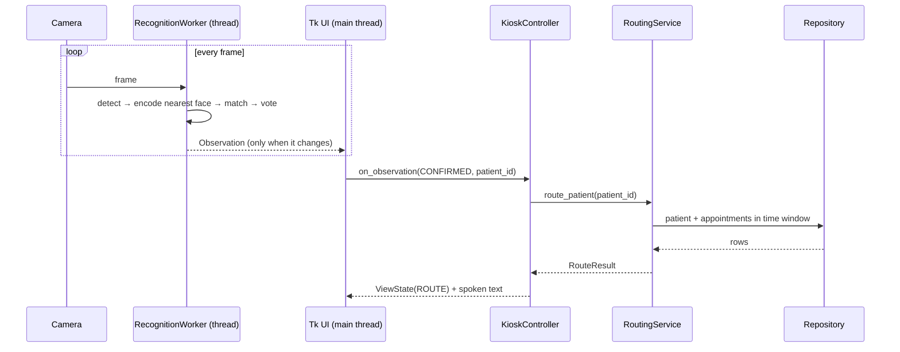
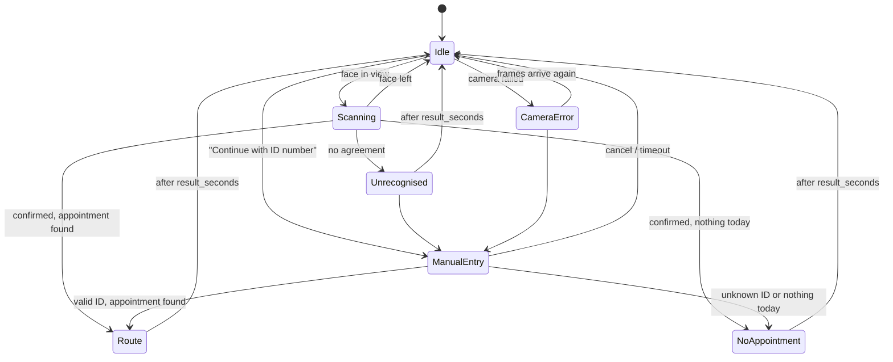

# Architecture

The code is split so that everything that decides *what the patient sees* is plain Python
with no hardware, and is covered by tests. Cameras, dlib and Tkinter sit at the edges.

```
src/hasta_yonlendirme/
├── cli.py                 command-line interface (run, enroll, forget, demo…)
├── config.py              TOML settings + environment secrets, validated
├── models.py              Patient, Clinic, Doctor, Appointment, RouteResult
├── identity.py            T.C. Kimlik No checksum and keyed hashing
├── routing.py             which appointment to show
├── announcer.py           spoken directions (espeak-ng)
├── camera.py              OpenCV and Picamera2 cameras
├── i18n.py                Turkish and English text
├── recognition/
│   ├── base.py            FaceEncoder interface, DetectedFace
│   ├── dlib_backend.py    face detection and encoding (the only dlib import)
│   ├── matcher.py         FaceGallery, FaceMatcher: distance, tolerance, ambiguity
│   └── pipeline.py        Recognizer (nearest face) and VoteConfirmer (frame agreement)
├── storage/
│   ├── base.py            Repository interface
│   ├── sql.py             shared SQL implementation
│   ├── sqlite.py          SQLite schema
│   └── mysql.py           MySQL schema and reconnects
└── kiosk/
    ├── controller.py      the kiosk state machine (no GUI code)
    ├── worker.py          camera + recognition thread
    ├── tk_ui.py           full-screen touch interface
    ├── console_ui.py      text interface for development
    └── app.py             wiring
```

## Data flow



Recognition runs on its own thread because face detection takes a noticeable part of a
second on a Raspberry Pi. The worker sends only *changes* through a queue; the UI drains it
every 50 ms, so the screen never freezes while a frame is being processed.

## Recognition decisions

For each frame:

1. **Detect** all faces (HOG detector by default, on a frame shrunk by `downscale`).
2. Keep the **largest** face: the person standing at the kiosk, not people walking past.
   Faces smaller than `min_face_size` are ignored as too far away.
3. **Encode** it as 128 numbers.
4. **Match** against the gallery. For each patient the closest of their stored encodings
   counts. The result is
   - `MATCH` if the best distance is at most `tolerance` **and** the runner-up patient is at
     least `ambiguity_margin` further away,
   - `AMBIGUOUS` if two patients are almost equally close,
   - `UNKNOWN` otherwise.
5. **Vote.** A patient is confirmed only after `confirm_frames` consecutive frames agree.
   After 15 frames with a face but no agreement, the verdict is `UNRECOGNISED` and the kiosk
   offers the ID-number path.

The defaults (`tolerance = 0.5`, stricter than the library's 0.6; margin 0.06; 3 frames)
favour "not recognised" over "wrong person": a patient who is not recognised loses a few
seconds, a patient sent to the wrong clinic loses much more.

## Kiosk states



While a result or the keypad is on screen the worker is paused, which saves CPU and keeps
the camera from interrupting a patient who is reading.

## Which appointment is shown

`RoutingService` looks at scheduled appointments from `late_arrival_minutes` ago to
`early_arrival_minutes` ahead. If any are still ahead, the nearest one wins; otherwise the one
that started most recently. Cancelled and completed appointments are ignored.

## Connecting to your hospital system

The kiosk only needs the read side of [`Repository`](../src/hasta_yonlendirme/storage/base.py):

```python
class HospitalRepository:
    def get_patient(self, patient_id: int) -> Patient | None: ...
    def find_patient_id(self, national_id_hash: str) -> int | None: ...
    def load_encodings(self) -> list[tuple[int, Encoding]]: ...
    def appointments_between(self, patient_id: int, start: datetime, end: datetime) -> list[Appointment]: ...
    def close(self) -> None: ...
```

Typical options:

- **Read replica.** Point the kiosk at a read-only replica of the hospital database and
  translate the four queries above to its schema.
- **API.** Implement the methods as calls to the hospital's HL7 FHIR or REST API
  (`Patient`, `Appointment`, `Location` resources map naturally).
- **Sync job.** Keep the bundled MySQL schema and fill the `appointments` table from the
  hospital system every few minutes.

Face encodings are new data the hospital system does not have; keep them in the bundled
`face_encodings` table (or an equivalent store) with access restricted to the kiosk.

## Performance notes

On a Raspberry Pi 4 the biggest levers are, in order:

1. `downscale` — detection time falls roughly with the number of pixels.
2. `detection_model = "hog"` — the CNN detector is far too slow without a GPU.
3. Camera resolution — 640×480 is plenty for a person standing at arm's length.

`hasta-yonlendirme check-camera` prints the frames per second including detection, so you
can tune these on the actual device.
